# Autonomous YouTube Agent — System Architecture

## 1. Product Overview & Goals

The Autonomous YouTube Agent is an AI-assisted video production and publishing platform designed to automate content planning, metadata packaging, and scheduled YouTube distribution while keeping operating costs strictly at \$0 until revenue generation.

### Core Workflow

```mermaid
flowchart LR
    A["User Profile & Topics Schedule"] --> B["Morning Scheduler (07:00)"]
    B --> C["Topic Research Service"]
    C --> D["Single LLM Call (Content Package)"]
    D --> E["Packaging: Long-Form & Shorts Scripts/Metadata"]
    E --> F["Human Video Generation (External Tool)"]
    F --> G["Video Upload & Validation"]
    G --> H["YouTube Data API v3 (Scheduled Publication)"]
```


---

## 2. Architectural Style: Modular Monolith

The system uses a **Modular Monolith** architecture pattern. 
- **Rationale**: Keeps deployment, continuous operations, transactions, and state management simple for a solo developer. Avoids the distributed tracing, network latency, multiple container deployments, and message queue operational overhead of microservices before product-market fit.
- Internal domains are decoupled using explicit interfaces and services (`services/` and `integrations/`).

---

## 3. Technology Stack & Component Responsibilities

### 3.1 Frontend
- **Framework**: React 18, TypeScript (Strict Mode), Vite.
- **Role**: Lightweight dashboard for configuring profiles, viewing daily generation packages, uploading rendered MP4s, checking publishing statuses, and verifying service health.
- **Security Boundary**: Runs in the client browser. Never accesses database or third-party API credentials directly. Communicates exclusively with backend API.

### 3.2 Backend
- **Framework**: Python 3.10-3.12, FastAPI, Uvicorn, Pydantic V2, Pydantic-Settings.
- **Role**: Central coordinator for scheduling, research aggregation, LLM inference dispatch, media validation, encryption of OAuth tokens, and YouTube Data API interaction.
- **Execution Model**: Asynchronous API with background workers for prolonged workflows.

### 3.3 Database Layer
- **Database**: Supabase-hosted PostgreSQL.
- **ORM & Migrations**: SQLAlchemy 2.0 (declarative mapping) and Alembic.
- **Connection Strategy**:
  - Cloud / IPv6 environments: Direct connection to port 5432 with SSL.
  - Local / IPv4 restricted environments: Supabase Session Pooler (port 6543, transaction/session mode).
  - SQLAlchemy Engine: Connection pool kept conservative (`pool_size=5`, `max_overflow=2`) to fit comfortably within free-tier connection limits (typically 60 direct / 15 pooler connections).

---

## 4. Third-Party Integrations Design

### 4.1 LLM Gateway (OpenRouter)
- **Zero-Paid-API Constraint**: Exclusively targets free-tier models (`:free` suffix or `openrouter/free` router).
- **Single-Call Orchestration**: The Content Generation Service makes exactly **one** LLM request per daily topic. The prompt instructs the model to return a single unified JSON object complying with a strict JSON schema containing:
  - Long-form video title, description, tags, scene-by-scene script, narration, caption draft, thumbnail conceptual prompt.
  - YouTube Shorts title, script, description, hashtags, audio cues.
- **Fallback Policy**: Fails gracefully if free quota is depleted (`429` / `402`). Never falls back to a paid model.
- **Interface**:
  ```python
  class LLMProvider(ABC):
      async def generate_structured(self, request: LLMRequest) -> LLMResponse: ...
  ```

### 4.2 YouTube Data API v3 & OAuth 2.0
- **Flow**: Server-side Authorization Code Flow with offline access (`access_type=offline`) to obtain refresh tokens.
- **Scopes (Least Privilege Principle)**:
  - `https://www.googleapis.com/auth/youtube.upload` (Video uploads & scheduling)
  - `https://www.googleapis.com/auth/youtube.force-ssl` (Captions, thumbnails, metadata update)
- **Token Storage**: Refresh tokens encrypted at rest using AES-GCM / Fernet via `GOOGLE_TOKEN_ENCRYPTION_KEY`.

---

## 5. Scheduler, Worker & Media Architecture

### 5.1 Scheduling Engine
- In early phases: Embedded asynchronous scheduler (`APScheduler` or FastAPI background task loops) tied to user's configured timezone (default: `Asia/Kolkata`).
- Future production: Distributed worker (e.g. Celery + Redis or standalone containerized runner) to ensure jobs persist across deployments.

### 5.2 Media Storage Strategy
- Temporary local upload staging directory (`./temp_media/`).
- Validates file format (`mp4`, `mov`, `mkv`), file size (<500MB), aspect ratio (16:9 for long-form, 9:16 for Shorts), and duration.
- Once video is uploaded to YouTube, local temporary files are securely cleaned up to avoid disk exhaustion on constrained hosting environments.

---

## 6. Security Boundaries

1. **Secrets Isolation**: No secrets stored in source repository. Centralized through Pydantic `Settings`.
2. **CORS Enforcement**: Restricted to explicit `FRONTEND_ORIGIN` list.
3. **Database Security**: Remote connections enforce `sslmode=require`. Parameterized queries prevent SQL injection.
4. **Rate Limiting & Safe Responses**: Diagnostics and health endpoints never reveal database credentials, passwords, or upstream API keys.
