# Autonomous YouTube Agent — System Architecture

## 1. Product Overview & Architectural Style

The Autonomous YouTube Agent is an AI-assisted video production and publishing workspace built around a **Modular Monolith** architecture pattern.

### Core Workflow

```mermaid
flowchart LR
    A["Creator Profile & Topic Schedule"] --> B["Morning Scheduler (07:00)"]
    B --> C["Topic Research Service"]
    C --> D["Single LLM Request (Content Package)"]
    D --> E["Packaging: Scripts & Publishing Metadata"]
    E --> F["Human Video Creation (External Tool)"]
    F --> G["Media Upload & Validation"]
    G --> H["YouTube Data API v3 (Scheduled Publication)"]
```

---

## 2. Persistent Data Model Architecture (Phase 1)

The Phase 1 database schema establishes persistent domain entities using SQLAlchemy 2.0 and Alembic migrations:

1. **`creator_profiles`**: Central creator configuration including niche, audience, style, IANA timezone, workflow times, and publishing preferences.
2. **`weekly_topic_schedules`**: Recurring topics assigned to days of the week (`day_of_week_enum`) with unique constraints per profile.
3. **`content_packages`**: Daily production package containing topic, target date, lifecycle status (`content_package_status_enum`), structured research bundle (JSONB), and generated scripts/metadata (JSONB).
4. **`workflow_jobs`**: Persistent asynchronous background work tracking with idempotency keys (`idempotency_key`), retry limits, scheduled execution times, and status tracking.
5. **`media_assets`**: Metadata for uploaded video, short, caption, or thumbnail files (file size, checksum SHA256, duration, dimensions, storage key).
6. **`publishing_records`**: Tracking entity for YouTube publishing status (`publishing_status_enum`), intended privacy, scheduled publication time, and external YouTube video IDs.
7. **`notifications`**: Operational creator notifications and reminders for upcoming deadlines or workflow alerts.

---

## 3. Timezone & Scheduling Conventions

To prevent publishing timing errors across geographic regions:
- **Storage Rule**: All execution and event timestamps (`created_at`, `scheduled_for`, `started_at`, `intended_publish_at`) are strictly stored as timezone-aware UTC timestamps (`TIMESTAMP WITH TIME ZONE`).
- **Creator Schedule Rule**: Recurring daily wall-clock schedules (`morning_workflow_time`, `long_form_publish_time`, `shorts_publish_time`) are stored as naive `TIME` objects and evaluated strictly within the creator's explicit IANA timezone string (e.g. `Asia/Kolkata`, `America/New_York`).
- **Validation**: Timezone strings are validated at API entry using Python 3.10+ `zoneinfo.ZoneInfo`.

---

## 4. Frontend Visual Identity — Retro YouTube Studio Design System

The frontend adopts a unified retro web design inspired by classic 1990s/early-2000s computer interfaces and creator consoles, adapted for YouTube content workflows:
- **Design Tokens**: Managed in `styles/tokens.css`.
- **Palette**: Space Navy (`#100d2d`), Deep Indigo (`#1b1544`), Panel Purple (`#34206b`), Retro Orange (`#ff792f`), Electric Teal (`#20b8b0`), Warm Cream (`#f7e8c5`).
- **Typography**: Monospace and system UI fonts combined with retro pixel aesthetics.
- **Reusable Components**: `AppShell`, `RetroWindow`, `PixelButton`, `StatusBadge`.

---

## 5. Security & Boundary Rules

1. **Credential Isolation**: No secrets committed to git. Private keys and database credentials restricted to backend environment.
2. **Frontend Protection**: Browser-safe environment variables restricted to `VITE_API_BASE_URL`.
3. **Database Parameterization**: SQLAlchemy ORM queries prevent SQL injection.
4. **Zero-Paid-API Budget**: LLM inference restricted to OpenRouter free-tier endpoints (`:free`). Video generation APIs intentionally excluded.
5. **No Docker Requirement**: Execution runs natively on host environment.
